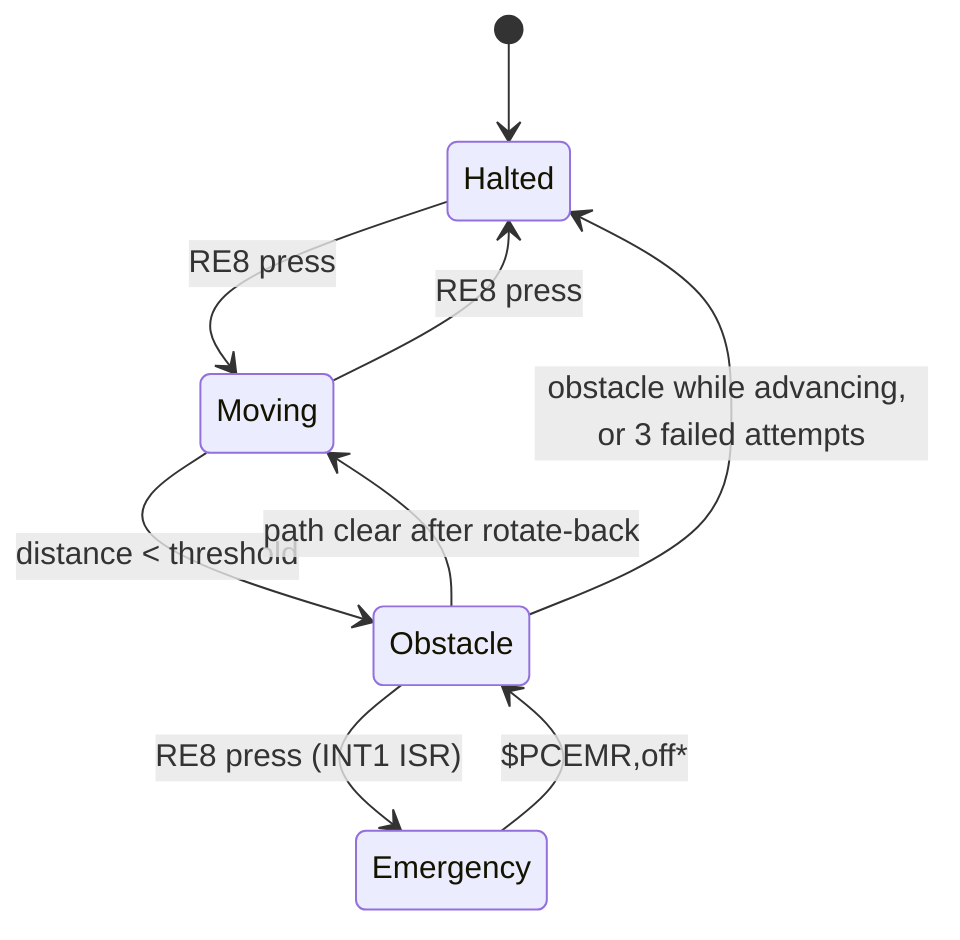

# Autonomous Buggy Firmware: dsPIC33EP512MU810

Firmware for a differential-drive buggy running on a **dsPIC33EP512MU810**. The buggy follows speed and yaw-rate references sent from a PC over UART. It detects obstacles with an IR distance sensor and avoids them autonomously using magnetometer heading, and it streams sensor telemetry back to the PC. A finite-state machine runs the behaviour, with four states (Halted, Moving, Obstacle avoidance, Emergency) and a push-button emergency stop.

---

## Features

- **500 Hz control loop** paced by Timer1 (2 ms period)
- **PC command protocol** over UART1 (`$...*` framed messages) for motion references, logging control, runtime configuration and emergency clear
- **Interrupt-driven UART** with separate TX (256 B) and RX (64 B) circular buffers
- **4 PWM channels** (Output Compare, 10 kHz) driving left and right motors forward and backward
- **IR distance sensing** and **battery monitoring** via the 12-bit ADC in hardware scan / auto-sample mode
- **IMU over SPI** (accelerometer, magnetometer, gyroscope) with a 4-sample moving-average filter. It provides roll, pitch, yaw and angular rates
- **Obstacle avoidance**: rotate 90° clockwise, advance for 2 s, rotate 90° back, with up to 3 attempts
- **Emergency stop** on RE8 via the INT1 interrupt: the motors stop immediately, from inside the ISR
- **Debounced buttons** (20 ms) for the Halted/Moving toggle (RE8) and the buffer-status report (RE9)
- **Lights** that show the state: indicators, low beams and a heartbeat LED
- **ISR-safe shared state**: the FSM uses a snapshot-and-commit pattern, so a state change made by the ISR is never overwritten by the main loop

---

## Hardware

| Item | Details |
|---|---|
| MCU | dsPIC33EP512MU810 |
| Instruction clock | **Fcy = 72 MHz assumed**. The Timer1, UART baud and PWM constants are all computed from it |
| IMU | Bosch accelerometer / magnetometer / gyroscope on SPI1 (BMX055-style register map; gyro at default ±2000 °/s, 16.4 LSB per °/s) |
| Distance sensor | Analog IR sensor, usable range 10–150 cm |
| Battery | Measured through a 1:3 voltage divider |

> **Note:** The project sets no oscillator configuration bits. The 72 MHz clock must come from the board setup or bootloader. If it is different, update `TICKS_PER_MS` (timer.c), `UART1_BRG_VALUE` (uart.c) and `PWM_PERIOD` (motor.c).

### Pin map

| Function | Pin | Notes |
|---|---|---|
| Left motor forward / backward | RD2 (OC2) / RD1 (OC1) | 10 kHz edge-aligned PWM |
| Right motor forward / backward | RD4 (OC4) / RD3 (OC3) | 10 kHz edge-aligned PWM |
| UART1 TX / RX | RD0 (RP64) / RD11 (RPI75) | 9600 baud, 8N1 |
| SPI1 SCK / SDO / SDI | RF12 (RP108) / RF13 (RP109) / RA1 (RPI17) | Mode 3, 9 MHz |
| Accelerometer CS | RB3 | |
| Gyroscope CS | RB4 | |
| Magnetometer CS | RD6 | |
| IR sensor output / enable | RB14 (AN14) / RB9 | RB9 driven high to power the sensor |
| Battery voltage | RB11 (AN11) | |
| Button 1 | RE8 (INT1 via RPI88) | Halted/Moving toggle (debounced), emergency stop (ISR) |
| Button 2 | RE9 | Sends a `$MBUF` report (debounced) |
| Left indicator | RB8 | |
| Right indicator | RF1 | |
| Low-intensity lights | RG1 | |
| Brake lights | RF0 | Initialised, not used by the FSM |
| Beam headlights | RA7 | Held low |
| Heartbeat LED (LD1) | RA0 | Blinks at 1 Hz while the main loop runs |

---

## Building and flashing

**Requirements**
- MPLAB X IDE
- XC16 compiler (the project was configured with **v2.10**)
- A programmer/debugger supported by MPLAB X (PICkit, ICD, etc.)

**Steps**
1. In MPLAB X, choose **File → Open Project** and select the `Final Project v2.X` folder.
2. Choose your programmer under **Project Properties → Connected Hardware Tool**. The project currently has no tool set.
3. **Build** (hammer icon), then **Make and Program Device**.

The generated `Makefile` can also build the project from the command line on a machine with MPLAB X and XC16 installed:
```bash
make CONF=default
```

---

## Architecture

### Main loop (500 Hz)

Each 2 ms tick in `main.c`:

1. `parser_process()` parses any bytes in the UART RX buffer.
2. `adc_update()` caches the latest battery and IR conversions.
3. RE8 and RE9 are debounced. A confirmed press triggers the state toggle or the `$MBUF` report.
4. The heartbeat LED is updated.
5. The IR distance is sampled every tick and averaged for the 10 Hz report.
6. Periodic telemetry is sent on staggered phases (see below).
7. `fsm_update()` runs last, so it uses this tick's sensor values.
8. `tmr_wait_period()` waits for the next tick.

### Telemetry scheduling

The reports share a 100 ms window of 50 ticks. Each report has its own offset so the TX buffer never fills with several messages in the same tick:

| Message | Phase (tick) | Offset | Rate |
|---|---|---|---|
| `$MDIST` | 0 | 0 ms | 10 Hz (mean of the 50 samples since the last report) |
| `$MANGLE` | 12 | 24 ms | 10 Hz (IMU is read and filtered here) |
| `$MGYRO` | 25 | 50 ms | 10 Hz (values cached at the `$MANGLE` phase) |
| `$MBATT` | 37 | 74 ms | 1 Hz (every 10th window) |

### Source files

| File | Purpose |
|---|---|
| `main.c` | Initialisation, 500 Hz loop, button debouncing, IMU filtering and attitude computation, telemetry scheduling, INT1 ISR |
| `fsm.c/.h` | State machine, obstacle-avoidance manoeuvre, emergency handling, ISR-safe state commit |
| `parser.c/.h` | `$...*` frame extraction and command handling, with bounds-checked integer parsing |
| `uart.c/.h` | Interrupt-driven UART1 with TX/RX circular buffers and overrun recovery |
| `cbuffer.c/.h` | Single-producer/single-consumer circular buffer with caller-provided storage |
| `motor.c/.h` | Output Compare PWM setup, signed duty → H-bridge pin mapping, runtime max-speed saturation |
| `adc.c/.h` | ADC1 scan of AN11/AN14, battery voltage and IR distance conversion |
| `spi.c/.h` | SPI1 master setup and blocking byte transfer |
| `imu.c/.h` | Accelerometer, magnetometer and gyroscope register access and raw-axis decoding |
| `timer.c/.h` | Timer1/Timer2 period setup, period wait with deadline-miss detection, blocking delay |
| `lights.c/.h` | Indicator, low-beam and brake light outputs |

---

## State machine



| State | Motors | Left indicator | Right indicator | Low beams |
|---|---|---|---|---|
| **Halted** | Stopped | Blink 1 Hz | Blink 1 Hz | Off |
| **Moving** | Follow `$PCREF` | Off | Off | On |
| **Obstacle** | Avoidance manoeuvre | Off | Blink 1 Hz | On |
| **Emergency** | Stopped | Off | Off | Off |

**Moving.** The wheel commands are computed from the PC reference as
`left = speed − yawrate`, `right = speed + yawrate` (in %), then saturated to `±MAXSPEED`. A positive yaw rate turns the buggy anticlockwise.

**Obstacle avoidance.** The state is entered when the IR distance drops below the threshold (20 cm by default). The manoeuvre speed is `|speed|` from the last reference, raised to at least 40% so the wheels can actually turn the buggy.
1. **Rotate clockwise** until the magnetometer yaw has changed by 90°.
2. **Advance** for 2 s. If an obstacle is detected during this phase, go to **Halted**.
3. **Rotate anticlockwise** by 90°, back to the original heading.
4. If the path is clear, return to **Moving**. Otherwise retry from step 1. After 3 attempts, go to **Halted**.

**Emergency.** Pressing RE8 during obstacle avoidance triggers INT1. The ISR stops the motors right away, without waiting for the next loop tick. `$PCEMR,off*` resumes obstacle avoidance where it left off. The turn reference is re-anchored to the current heading, because the buggy may have been moved while stopped.

**Concurrency.** `fsm_update()` reads the state with INT1 disabled, works on a local copy, and commits its result only if the ISR has not changed the state in the meantime. An emergency raised mid-update therefore always takes precedence.

---

## Serial protocol

UART1 runs at 9600 baud, 8N1. Every message has the form `$PAYLOAD*`: a frame starts at `$` and ends at `*`, and characters outside a frame are ignored. Payloads longer than 31 characters are discarded. Valid commands are not acknowledged. Malformed or out-of-range commands get `$ERR*` in reply.

### PC → buggy

| Command | Effect | Valid range |
|---|---|---|
| `$PCREF,speed,yawrate*` | Set the motion reference (used in Moving) | each −100…100 (%) |
| `$PCLOG,BATT,x*` | Enable (1) / disable (0) `$MBATT` | 0 or 1 |
| `$PCLOG,DIST,x*` | Enable / disable `$MDIST` | 0 or 1 |
| `$PCLOG,ANGLE,x*` | Enable / disable `$MANGLE` | 0 or 1 |
| `$PCLOG,GYRO,x*` | Enable / disable `$MGYRO` | 0 or 1 |
| `$PCCFG,THRESHOLD,cm*` | Obstacle trigger distance | clamped to 10…150 cm |
| `$PCCFG,MAXSPEED,pct*` | Motor duty saturation | clamped to 0…100 % |
| `$PCEMR,off*` | Clear Emergency and resume | — |

All logs are enabled at power-up.

### Buggy → PC

| Message | Content |
|---|---|
| `$MDIST,d*` | Mean IR distance over the last 100 ms, in cm (integer, 10–150) |
| `$MANGLE,roll,pitch,yaw*` | Attitude in degrees (roll/pitch from the accelerometer, yaw from the hard-iron-corrected magnetometer) |
| `$MGYRO,gx,gy,gz*` | Filtered angular rates in °/s |
| `$MBATT,v*` | Battery voltage in V |
| `$MBUF,tx,rx*` | Bytes currently held in the TX and RX buffers (sent when RE9 is pressed) |
| `$ERR*` | The last command was rejected |

### Example session
```
→ $PCREF,50,0*            drive straight at 50 %
→ $PCCFG,THRESHOLD,30*    trigger avoidance at 30 cm
→ $PCLOG,GYRO,0*          stop gyro reports
← $MDIST,87*
← $MANGLE,1.25,-0.40,132.70*
← $MBATT,7.92*
→ $PCREF,150,0*
← $ERR*                   speed out of range
```

---

## Calibration and tunable parameters

| Parameter | Location | Default | Meaning |
|---|---|---|---|
| `MAG_OFFSET_X`, `MAG_OFFSET_Y` | `main.c` | 152, −238 | Magnetometer hard-iron offsets, (min + max) / 2 per axis over a full rotation. **Recalibrate for each buggy.** |
| `IMU_FILTER_N` | `main.c` | 4 | Moving-average window (power of two) |
| `DEBOUNCE_TICKS` | `main.c` | 10 | Button settle time (×2 ms) |
| `THRESHOLD_CM_DEFAULT` | `fsm.c` | 20 | Default obstacle distance (cm) |
| `MANEUVER_MIN` | `fsm.c` | 40 | Minimum manoeuvre duty (%) |
| `TURN_TARGET` | `fsm.c` | 90.0 | Avoidance turn angle (°) |
| `FORWARD_TICKS` | `fsm.c` | 1000 | Advance duration (ticks, i.e. 2 s) |
| `MAX_ATTEMPTS` | `fsm.c` | 3 | Avoidance retries before halting |
| `BATTERY_RATIO` | `adc.c` | 3.0 | Battery divider ratio |

The IR conversion in `adc_read_distance()` is a 4th-order polynomial fit from voltage to distance. Replace its coefficients if you use a different sensor.

**Calibrating the magnetometer:** temporarily send the raw `mag.x` / `mag.y` values over UART, rotate the buggy slowly through a full turn on a flat surface, record the minimum and maximum on each axis, and set each offset to `(min + max) / 2`.

---

## Project layout

```
Final Project v2.X/
├── main.c
├── fsm.c / fsm.h
├── parser.c / parser.h
├── uart.c / uart.h
├── cbuffer.c / cbuffer.h
├── motor.c / motor.h
├── adc.c / adc.h
├── spi.c / spi.h
├── imu.c / imu.h
├── timer.c / timer.h
├── lights.c / lights.h
├── Makefile                 # MPLAB X generated
└── nbproject/               # MPLAB X project configuration
```
